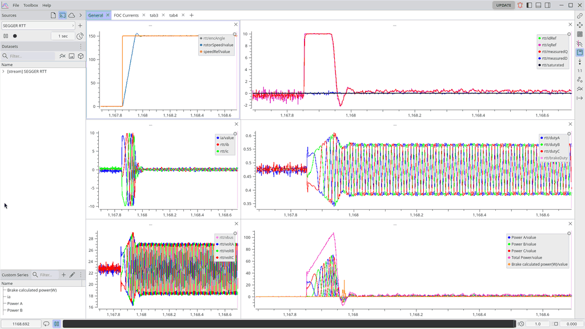

# plotjuggler-rtt

Plot live telemetry from a microcontroller in [PlotJuggler](https://github.com/PlotJuggler/PlotJuggler), a free desktop app for exploring time series, streamed over SEGGER RTT as packed binary records. The record layout is described in a JSON file, so when your firmware's telemetry changes you edit the JSON, not the plugin.



*A speed step on a BLDC motor controller (STM32F405), streamed live through the plugin and shown at quarter speed. The power plot is a PlotJuggler custom series computed from the streamed fields.*

This is the version for **PlotJuggler 4**. For PlotJuggler 3.x, use the [`pj3` branch](https://github.com/DaviVolcan/plotjuggler-rtt/tree/pj3) (tag `v0.1.0-pj3`).

## Why

Plotting signals from firmware usually means `printf` over a UART and a script that parses text. That costs CPU time on the target, needs a free serial port, and tops out at the baud rate.

[RTT](https://kb.segger.com/RTT) (Real-Time Transfer) is SEGGER's alternative: the firmware writes into a ring buffer in RAM and the J-Link probe reads that memory in the background through the debug port, without halting the CPU. No extra pins, no baud rate, and writing a record costs about as much as a `memcpy`. If you already debug with a J-Link, you already have it.

What RTT does not give you is framing. It is a plain byte stream, and the host almost never connects at the start of a record. A reader that assumes it does will decode shifted bytes into numbers that look plausible and are wrong. This plugin finds record boundaries with a 4-byte magic word, checks it on every record, and resynchronises on its own if bytes go missing.

The other problem is keeping host and firmware in agreement. Here the layout lives in a JSON *data map* that you keep next to your firmware. Adding a field to the record means adding a line to the JSON. The plugin is never rebuilt.

## How it works

```
 firmware                     J-Link software                PlotJuggler
┌───────────────────┐  SWD   ┌──────────────────────┐ TCP   ┌──────────────────────┐
│ packed struct     │──────▶ │ RTT telnet server    │─────▶ │ plotjuggler-rtt      │
│ SEGGER_RTT_Write  │        │ localhost:19021      │       │ + telemetry_map.json │
└───────────────────┘        └──────────────────────┘       └──────────────────────┘
```

- Every record starts with the same 32-bit magic. The plugin syncs on it, skips the J-Link text banner, and drops anything that does not line up.
- The time axis comes from a counter in the record (`seq / nominal_rate_hz`), so plots use the target's clock. USB and OS scheduling jitter on the PC do not distort them.
- When the counter jumps back to zero (the target was reset), the new run is placed one second after the previous one on the time axis, so the two never overlap.
- Lost records and rejected records are published as `rtt/_diag/lost_records` and `rtt/_diag/malformed`, so you can plot them next to your data.
- Optionally, every run is also written to its own CSV file.

## New to PlotJuggler?

[PlotJuggler](https://github.com/PlotJuggler/PlotJuggler) is an open-source (MPL-2.0) desktop application for plotting time series, used widely in robotics and drones. You do not write any plotting code: once this plugin feeds it your firmware's signals, this is what you get on the bench.

- **Drag and drop.** Every field of your record shows up in a list; drag it onto a plot. Split the window into as many plots and tabs as you need.
- **Pause and look back.** Stop the stream at any moment, zoom into a few milliseconds, scroll back through the buffer, or replay it with the timeline at the bottom.
- **Compute signals without reflashing.** Combine streamed fields with a one-line Lua or Python function in the Transform Editor: the per-phase power in the plot above comes from the three terminal voltages and the phase current. Ready-made filters cover derivative, integral, moving average, RMS, scale and offset, and outlier removal.
- **Keep the setup.** Save the plot arrangement as a layout file and reopen the same bench view next time.
- **More tools from the Marketplace.** *File → Marketplace* adds an FFT toolbox, to find the frequency of an oscillation or noise, and a data exporter, to take a capture to Python, MATLAB or a spreadsheet. This plugin can also save each run to a CSV file by itself.

## Quick start without hardware

`tools/fake_target.py` pretends to be a J-Link and streams the record from `examples/` at 1 kHz. It is the fastest way to see the plugin work.

1. Build the plugin (see [Building](#building)):

   ```sh
   scripts/build-sdk.sh ~/pj-sdk
   cmake -S . -B build -DCMAKE_BUILD_TYPE=Release -DCMAKE_PREFIX_PATH=~/pj-sdk
   cmake --build build
   ```

2. Start the fake target:

   ```sh
   python3 tools/fake_target.py
   ```

3. Start PlotJuggler 4 with the plugin folder:

   ```sh
   ./PlotJuggler-4.0.0-x86_64.AppImage --plugin-dir "$PWD/build"
   ```

4. Under *Sources*, open the stream tab, select **SEGGER RTT** and press **+**. Leave host, port and channel at their defaults and pick `examples/telemetry_map.json` as the data map.

5. Expand `[stream] SEGGER RTT` → `rtt` and drag `current_a` and `speed_rpm` into a plot. Every 10 seconds the fake target simulates a reset, and the new run appears one second after the previous one.

## Using it with your firmware

**1. Send a packed record on an RTT up-channel.** The first field is the magic; one field must be a counter that goes up by one per record.

```c
#define TELEMETRY_MAGIC 0xC3A55A01u  /* low byte: bump when the layout changes */

typedef struct __attribute__((packed)) {
    uint32_t magic;      /* offset 0 */
    uint32_t seq;        /* offset 4 */
    float    current_a;  /* offset 8 */
    float    speed_rpm;  /* offset 12 */
} telemetry_record_t;

SEGGER_RTT_ConfigUpBuffer(1, "Telemetry", buffer, sizeof(buffer),
                          SEGGER_RTT_MODE_NO_BLOCK_SKIP);
/* then, at a fixed rate: */
SEGGER_RTT_Write(1, &record, sizeof(record));
```

`SEGGER_RTT_MODE_NO_BLOCK_SKIP` drops a whole record when the buffer is full. A slow host then never stalls your control loop and never receives half a record.

**2. Describe the same record in JSON:**

```json
{
  "record_size": 16,
  "magic": "0xC3A55A01",
  "seq_field": "seq",
  "nominal_rate_hz": 1000,
  "fields": [
    {"name": "seq",       "offset": 4,  "type": "uint32"},
    {"name": "current_a", "offset": 8,  "type": "float32", "unit": "A"},
    {"name": "speed_rpm", "offset": 12, "type": "float32", "unit": "rpm"}
  ]
}
```

**3. Start a debug session** (for example J-Link GDB Server, or from your IDE), then start the plugin with your map. If your debug server uses another telnet port or channel, set them in the plugin's dialog; it remembers them.

A complete version, with a `_Static_assert` that catches a struct that no longer matches the map, is in [`examples/firmware/telemetry.c`](examples/firmware/telemetry.c). Every key of the data map, including burst captures replayed from a buffer, is documented in [`docs/data-map.md`](docs/data-map.md).

When you change the layout, change the low byte of the magic in both places. A plugin running an old map then stays unsynced and plots nothing, instead of plotting misaligned values.

## Capturing more than the link can carry

The debug link has a fixed bandwidth, and fast control loops easily produce more data than it can move. A motor current loop running at 8 kHz, streamed at 1 kHz, shows one sample in eight. That is enough to watch the motor run, but not to measure how fast the loop responds to a step, which is often the point of the test.

The way around it is to stop streaming the fast signals live and record them in RAM instead, only around the moment you care about, then send them afterwards at whatever rate the link allows:

```
                   trigger (setpoint step)
                   │
 control loop  ····█████████·········································  8 kHz, 128 samples kept in RAM (16 ms)
 RTT link      L L L L L L L L R R R R R R R ··· R R R R L L L L L L   1 kHz, L = live record, R = replayed sample
 PlotJuggler   live data at 1 kHz, with the burst drawn back at the trigger at 8 kHz
```

Replayed records carry a second magic word and the tick at which each sample was taken. The plugin puts every sample back at its original instant on the time axis, so the burst lines up with the live data around it. Only the fields the burst actually recorded are plotted, and the replay is neither mistaken for a target reset nor counted as lost data.

What it costs is RAM and latency. RAM limits how long the window can be: 128 samples of two floats is 1 KiB. The burst also shows up after the event, not while it happens. In the thesis that motivated this plugin, the firmware kept nine windows of 128 samples (four floats each, about 18.5 kB) around the steps of a current-loop test and replayed them in about 1.2 s after the run. That was enough to measure the loop's time constant and delay, which the 1 kHz live stream could not resolve.

[`examples/firmware/burst_capture.c`](examples/firmware/burst_capture.c) is a complete example with a pre-trigger ring buffer, and [`examples/burst_map.json`](examples/burst_map.json) is its data map. The keys involved (`dump_magic`, `dump_fields`, `seq_step`) are described in [`docs/data-map.md`](docs/data-map.md#burst-captures).

## Building

Requirements:

- CMake 3.22 or newer and a C++20 compiler
- The PlotJuggler plugin SDK, in the version the target PlotJuggler release was built with: **plotjuggler_sdk 0.34.1 for PlotJuggler 4.0.0**. `scripts/build-sdk.sh` downloads and installs it, with the libraries it needs, into a folder of your choice (about a minute).

```sh
scripts/build-sdk.sh ~/pj-sdk                 # once
cmake -S . -B build -DCMAKE_BUILD_TYPE=Release -DCMAKE_PREFIX_PATH=~/pj-sdk
cmake --build build
ctest --test-dir build                        # unit tests and an end-to-end test of the built plugin
```

asio, nlohmann/json and GoogleTest are downloaded at configure time when they are not installed.

The build produces `libsegger_rtt_streamer.so` and `segger_rtt_streamer.pjmanifest.json`. Keep the two files together and start PlotJuggler 4 with `--plugin-dir` pointing at their folder.

## Limitations

- **J-Link only.** The plugin talks to the RTT telnet server of SEGGER's J-Link software and has been used with J-Link GDB Server. OpenOCD and probe-rs also expose RTT over TCP but have not been tried.
- **One client per channel.** J-Link serves one telnet client at a time, so you cannot use RTT Viewer on the same port while the plugin is connected.
- **Little-endian targets.** Fields are decoded with a plain copy, which matches Cortex-M and most other MCUs.
- **Fixed-size records.** Every record has the same layout; variable-length messages are not supported.
- **Tested on Linux** with PlotJuggler 4.0.0 (AppImage). Windows and macOS builds have not been tried.
- **PlotJuggler's Record button does not record this source.** PlotJuggler 4 only records sources that hand it raw messages, and this plugin decodes records itself. Use the plugin's own CSV option instead.
- **Load layouts after starting the stream.** A layout with custom series computed from this stream only restores once the `[stream] SEGGER RTT` dataset exists.
- **A target reset does not clear the plots.** PlotJuggler 4 gives sources no way to do that, so each new run is placed after the previous one instead.
- **Keep the streaming buffer short.** At 1 kHz with about 25 curves and 8 custom series on screen, PlotJuggler 4.0.0 stayed smooth with a 5 s buffer and slowed down at 15 s. Long runs are better kept in the CSV files.

If all you need is to read text from `printf`, SEGGER's RTT Viewer is simpler. If the target has to stream with no debug probe attached, RTT is the wrong transport.

## Background

This plugin came out of my undergraduate thesis in Electrical Engineering at UCPel, Brazil: a field-oriented speed controller for a hoverboard BLDC motor, written from scratch on an STM32F405. Tuning the current and speed loops and comparing PI, PID and fuzzy controllers meant watching dozens of signals at once on the bench (phase currents, d/q currents, voltages, rotor angle, speed) and keeping every run for later analysis.

That came to 36 signals in a 133-byte record at 1 kHz, plus 8 kHz captures around each current step: about 133 kB/s, more than ten times what a UART at 115200 baud can carry. The firmware's record layout also changed many times as the project grew, so having to rebuild the plotting tool each time was not an option. The thesis bench data was captured with this plugin.

## Status

Version 0.2, for PlotJuggler 4. It works on the setup described above; other targets and probes have not been tested, and the data map format may still change.

## License

[Mozilla Public License 2.0](LICENSE), the same license as PlotJuggler.
